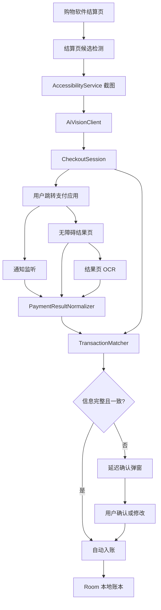

# LiteNote 界面复用与 AI 支付识别新项目启动文档

> 文档状态：项目启动基线（LiteNote 源码审计版）
>
> 目标：保留 LiteNote 的前端展示和确认交互，使用本地原生能力完成购物结算页识别、支付成功确认和本地记账。
>
> 参考项目：<https://github.com/GystuG/LiteNote>

> 设计原则：先定义数据和状态边界，再实现 UI 和识别适配；任何未经过真实设备样本验证的解析规则都只能产生候选，不能直接自动入账。

---

## 0. LiteNote 现状审计和复用决策

本节基于 LiteNote `main` 分支的公开源码目录和关键文件审计，不把 README 中的描述当作已经实现的能力。

### 0.1 移动端技术栈

LiteNote 移动端是 React Native 应用，关键版本和依赖包括：

- React Native `0.81.4`；
- React `19.1.0`；
- React Navigation Native Stack 和自定义底部导航；
- TanStack React Query，用于远程账单、统计、预算和目标数据缓存；
- React Native Paper、SVG、Gifted Charts 和自定义 Neo-Brutalism UI；
- AsyncStorage，用于 Token、用户资料和本地设置；
- Axios 封装的 HTTP 服务；
- 音频录制、图片选择、图片查看和 ZIP 更新依赖；
- Sentry React Native 日志；
- React Native Hot Update。

对应文件：

```text
litenote-mobile-app/package.json
litenote-mobile-app/App.tsx
litenote-mobile-app/src/navigation/AppNavigator.tsx
litenote-mobile-app/src/theme/
litenote-mobile-app/src/components/
litenote-mobile-app/src/hooks/
litenote-mobile-app/src/services/
```

### 0.2 LiteNote 已有的前端页面

以下页面已经存在，可以作为新项目 UI 的直接复用候选：

| 页面/能力 | 源码位置 | 新项目处理 |
|---|---|---|
| 首页仪表盘 | `src/screens/dashboard/DashboardScreen.tsx` | 保留布局，改为本地查询 |
| 底部导航 | `src/navigation/AppNavigator.tsx` | 保留视觉和交互，删除不需要的入口 |
| 全部账单 | `src/screens/finance/AllBillsScreen.tsx` | 保留，替换数据源 |
| 账单详情 | `src/screens/finance/BillDetailScreen.tsx` | 保留，增加来源和识别证据 |
| 新建/编辑账单 | `src/screens/finance/CreateBillScreen.tsx` | 保留，改成本地写入 |
| 分类管理 | `src/screens/finance/CategoryManageScreen.tsx` | 保留，迁移到本地分类 |
| 收支统计 | `src/screens/finance/StatisticsScreen.tsx` | 保留布局，改为本地统计 |
| 报表、日/月/年视图 | `src/screens/reports/` | 保留图表组件和交互 |
| 预算 | `src/screens/BudgetScreen.tsx` | 可复用 UI，新增本地模型和计算 |
| 财务目标 | `src/screens/FinancialGoalScreen.tsx` | 可复用 UI，新增本地模型和计算 |
| AI 对话 | `src/screens/ai/` | 可选保留，不能与支付视觉识别混用 |
| 通知设置 | `PaymentNotificationSettings.tsx` | 保留界面，增加无障碍、AI 和截图状态 |
| 登录/协议/个人资料 | `src/screens/auth/` | 默认移除；若未来需要云同步再启用 |
| 应用更新/热更新 | `UpdateModal.tsx`、`useHotUpdate.ts` | 本阶段移除云端依赖，另行设计本地升级 |

### 0.3 LiteNote 的前端数据和状态事实

LiteNote 当前不是本地账本应用，其前端数据流是：

```text
AuthProvider
  → AsyncStorage 保存 Token 和用户资料
  → Axios 添加 Bearer Token
  → NestJS API
  → React Query 缓存
  → 页面展示
```

具体事实：

- `AuthProvider.tsx` 负责登录、注册、Token 恢复、刷新资料和退出登录；
- `utils/nativeAuth.ts` 将 Token 同步给 Android 原生悬浮窗；
- `services/http.ts` 为请求添加 `Authorization` 和 `X-Request-ID`，处理 401 和网络错误；
- `services/api/bills.ts` 调用 `/bills`、`/bills/statistics`；
- `hooks/useDashboard.ts` 同时读取统计和最近账单，再由 React Query 缓存；
- `App.tsx` 当前只监听 `onBillCreated`，收到后使账单缓存失效；
- `stores/index.ts` 目前只是 MobX Store 的预留出口，没有承担账本状态；
- 后台原生服务不能依赖 React Native 页面一直存活。

新项目必须保留后台服务可独立运行的能力：支付会话、AI 结果和账单写入不能只存在 JS 内存中。

### 0.4 LiteNote Android 原生层的实际能力

#### 已实现

| 文件 | 实际行为 | 新项目处理 |
|---|---|---|
| `PaymentNotificationService.kt` | 监听微信/支付宝通知，合并八类字段，关键词过滤，金额正则提取 | 保留生命周期和字段读取，重写解析和会话投递 |
| `PaymentOverlayManager.kt` | 使用 `SYSTEM_ALERT_WINDOW` 显示全屏悬浮窗，加载分类，确认后调用账单 API | 保留视觉和分类交互，改为条件弹窗和本地提交 |
| `BillApiService.kt` | `GET /categories`，`POST /bills`，使用原生保存的 Bearer Token | 移除远程账单调用，替换为 Native Repository |
| `PaymentNotificationModule.kt` | 暴露通知/悬浮窗权限和监听配置给 RN | 扩展为本地识别状态和待确认事件桥接 |
| `PaymentNotificationHeadlessService.kt` | 声明 Headless JS 服务 | 当前支付通知服务没有实际调用它，不能视为已打通的后台链路 |
| `BootCompletedReceiver.kt` | 开机广播入口 | 评估后保留服务状态恢复，不直接启动支付 UI |

#### 当前支付通知的真实流程

```text
onNotificationPosted
→ 检查包名是否在 monitored_apps
→ 合并 title/titleBig/text/subText/summaryText/bigText/infoText/tickerText
→ 排除“收款/到账/收到/转入/红包”
→ 命中任意 paymentKeywords
→ 使用金额正则提取金额
→ 立即调用 showPaymentOverlay
→ 悬浮窗加载远程分类
→ 用户选择分类后 POST /bills
```

当前实现的关键限制：

- 任何命中关键词和金额的通知都会尝试显示悬浮窗；
- 没有购物软件结算页会话；
- 没有 AI 结果关联；
- 没有支付通知去重键；
- 没有通知更新/撤回处理；
- 没有“信息完整自动入账，缺失才弹窗”的决策层；
- `onConfirm` 回调在 `PaymentOverlayManager` 内并不是实际账单提交入口，悬浮窗内部直接调用 `BillApiService`；
- 分类列表必须通过后端获取，离线时确认记账会失败；
- 悬浮窗默认 60 秒自动消失；
- Manifest 声明了 Headless JS，但 `PaymentNotificationService` 当前没有启动该服务。

### 0.5 LiteNote 后端和数据库的实际能力

LiteNote 后端是 NestJS + Prisma + PostgreSQL，应用模块包括：

```text
AuthModule
BillsModule
CategoriesModule
AccountsModule
BudgetsModule
FinancialGoalsModule
AIModule
AppVersionModule
HotUpdateModule
```

Prisma 当前模型包括：

```text
User
AIModelConfig
Category
Bill
Account
Budget
FinancialGoal
AppVersion
ChatSession
HotUpdate
ChatMessage
```

重要字段：

- `Bill` 有金额、收入/支出类型、描述、日期、时间、分类、账户、标签、备注、收据 URL 和来源；
- `Account` 有账户类型和余额，但支付通知代码没有把支付方式自动映射到 `accountId`；
- `Category` 支持系统默认分类和用户分类；
- `Budget` 和 `FinancialGoal` 依赖后端聚合数据；
- `AIModelConfig` 保存服务商、模型、自定义 Base URL、API Key 和 `supportsVision`；
- `ChatMessage` 支持 `imageUrl`，后端 AI 适配器支持图片内容块。

LiteNote 后端已经有 AI 图片解析的协议基础：

- `ParseBillDto` 接受 `image` 或 `text`；
- OpenAI 兼容适配器发送 `image_url`；
- Claude 适配器发送图片内容块；
- AI 适配器已经包含图片转 Base64、响应解析和账单字段校验。

但是这些能力属于“后端 AI 账单/聊天解析”，不是购物结算页实时识别流程。新项目可以移植请求封装、提示词和 JSON 校验思路，不能直接调用这些后端接口。

### 0.6 复用矩阵

| LiteNote 能力 | 复用方式 | 原因/改动 |
|---|---|---|
| 主题、颜色、排版、导航 | 直接复用或按原样迁移 | 是本项目的重要目标 |
| 首页、账单、统计、预算 UI | 保留 UI，替换查询层 | 页面依赖远程 API |
| 分类选择网格和上次分类 | 保留交互，改成本地分类 | 原实现强依赖 `/categories` |
| 支付悬浮窗视觉 | 保留布局和交互 | 触发时机、字段和提交方式必须重写 |
| 通知监听生命周期 | 复用基础结构 | 解析、去重、会话投递必须重写 |
| 默认支付关键词/金额正则 | 仅作候选规则 | 不能直接决定成功或自动入账 |
| `BillApiService` | 不复用网络提交 | 替换为本地 Room/Repository |
| AuthProvider/Token | 默认移除 | 无自有后端和云账号 |
| React Query | 可保留缓存抽象 | queryFn 改为 Native Module/本地流 |
| 后端 AI 图片适配器 | 移植协议和校验 | 改写为 Android 直连客户端 |
| AI 聊天、语音、拍照 | 可选保留 | 与支付识别分开验收，不能占用支付链路 |
| 热更新、远程 APK 更新 | 本阶段移除 | 依赖 LiteNote 后端和下载服务 |
| Sentry | 重新评估 | 不得上传原始通知、截图或 API Key |
| 账户、预算、目标 | UI 可复用，数据层重建 | 新项目本地模型需要明确范围 |
| Headless JS | 不作为识别核心 | 当前源码实际未接入，后台核心应放 Kotlin |

---

## 1. 设计结论

最终采用以下组合：

```text
LiteNote React Native 前端
        +
Android Kotlin 原生识别核心
        +
本地 Room 账本和支付会话
        +
购物软件结算页截图
        +
外部 AI API 直连
        +
微信/支付宝通知或结果页确认支付成功
```

明确不采用 LiteNote 后端作为账本服务。应用自身不提供后端，手机直接调用用户配置的外部 AI API；账单、交易会话、待确认记录和识别状态保存在本地。

核心判断原则：

```text
AI 负责识别“这笔钱可能买了什么”
通知或支付结果页负责确认“这笔钱是否真的支付成功”
本地规则负责决定“自动入账还是要求确认”
```

AI 不能单独证明支付成功，结算页截图也不能单独触发入账。

---

## 2. 背景和问题

当前逐个平台编写无障碍适配存在以下问题：

- 不同购物平台控件层级和文本字段不一致；
- WebView、Canvas、自绘控件可能不暴露可访问文本；
- Activity 类名和页面结构会随版本变化；
- 订单页、确认页、支付页和支付结果页容易混淆；
- 为每个平台维护商户和订单字段的成本高；
- 页面能被用户看见，不代表无障碍服务能读取同样的文本。

新方案将购物平台识别交给多模态 AI，将支付成功判断交给本地可信来源，从而把两个问题分开：

```text
购物结算页：平台、商户、订单和预计金额
微信/支付宝：支付应用、最终金额和成功状态
```

---

## 3. 目标范围

### 3.1 必须实现

- 复用 LiteNote 的核心界面视觉和确认交互；
- 支持购物软件结算页的通用检测；
- 在购物软件结算页自动截图；
- 直接调用外部多模态 AI API；
- 识别平台、商户、金额、订单号等候选字段；
- 建立跨应用支付会话；
- 通过微信/支付宝通知或结果页确认支付成功；
- AI 结果晚于支付结果时继续等待并关联；
- 信息完整时自动入账；
- 信息不足时延迟弹出确认窗口；
- AI 超时或截图失败时回退到通知和结果页识别；
- 截图只在内存中处理，不在设备本地持久化；
- 账单、候选交易和待确认记录本地保存；
- 防止通知、无障碍、AI 和 OCR 多次创建同一账单。

### 3.2 不在本阶段实现

- 使用 AI 单独判断“支付成功”；
- 自动点击支付按钮、填写密码或输入验证码；
- 读取或保存支付密码、短信验证码和完整银行卡号；
- 自建后端、云端账本和跨设备同步；
- 为每个购物平台编写完整控件 ID 适配；
- 将原始截图长期保存到本地或上传到日志系统；
- 对直接扫码支付强行推断不存在的购物平台。

---

## 4. 方案术语

| 术语 | 定义 |
|---|---|
| 购物软件 | 用户下单或结算的应用，例如京东、淘宝、美团、滴滴 |
| 支付应用 | 实际完成支付的应用，例如微信、支付宝 |
| 结算候选 | 从购物软件结算页截图中得到的 AI 候选信息 |
| 支付会话 | 从结算页出现到支付结果确认或过期的一段关联窗口 |
| 支付成功证据 | 微信/支付宝通知、结果页无障碍文本、结果页 OCR 或用户确认 |
| 信息完整 | 满足自动入账所需的字段、置信度和一致性条件 |
| 待确认交易 | 无法安全自动入账、需要用户补充或确认的候选交易 |
| 平台 | 京东、淘宝、美团等消费平台 |
| 商户 | 店铺、门店、服务商或收款方 |
| 支付渠道 | 微信、支付宝等完成支付的入口 |

---

## 5. 总体架构



### 5.1 模块分层

```text
React Native UI
  - 首页、账单、统计、设置、确认弹窗

Native Bridge
  - 查询本地数据
  - 发送用户操作
  - 推送后台识别事件

Kotlin Capture Core
  - 结算页检测
  - 截图
  - AI 请求
  - 通知监听
  - 无障碍结果识别
  - OCR

Local Domain/Data
  - 支付会话
  - 候选交易
  - 置信度和决策
  - 去重和合并
  - Room 账本
```

### 5.2 组件职责

| 组件 | 主要职责 |
|---|---|
| `CheckoutPageDetector` | 判断当前购物软件页面是否疑似结算页 |
| `CheckoutScreenshotCapture` | 截图、敏感页面拦截、裁剪、压缩和释放 |
| `AiVisionClient` | 调用外部 AI、校验 JSON、超时和重试 |
| `CheckoutSessionManager` | 创建、更新、过期和恢复支付会话 |
| `PaymentNotificationListener` | 监听微信/支付宝系统通知 |
| `PaymentResultReader` | 读取支付结果页节点文本 |
| `LocalOcrReader` | 在满足条件时识别支付结果页截图 |
| `PaymentResultNormalizer` | 将通知、无障碍和 OCR 结果统一为支付证据 |
| `TransactionMatcher` | 合并结算候选和支付成功证据 |
| `AutoBookkeepingDecision` | 决定自动入账、等待或弹窗确认 |
| `LedgerRepository` | 写入、修改、撤销和查询本地账单 |
| `ReactNativeBridge` | 向 LiteNote 前端提供本地数据和状态事件 |

---

## 6. 端到端业务流程

### 6.1 正常流程：AI 先返回

```text
1. 用户在购物软件进入结算页。
2. CheckoutPageDetector 检测到金额和结算词。
3. 页面稳定 300~800ms 后截图一次。
4. AiVisionClient 返回平台、商户和结算金额。
5. 本地创建 WAITING_PAYMENT 会话。
6. 用户点击支付并进入微信/支付宝。
7. 通知或支付结果页确认成功。
8. 结算金额与最终支付金额匹配。
9. 信息达到自动入账条件，直接写入账本。
10. 不弹出确认窗口。
```

### 6.2 正常流程：支付先成功

```text
1. 购物软件截图已经上传，但 AI 尚未返回。
2. 用户完成支付。
3. 通知或结果页确认成功。
4. 会话进入 WAITING_ENRICHMENT。
5. 等待 AI 返回，默认等待 5~15 秒。
6. AI 返回后完成匹配。
7. 信息完整则自动入账；信息不足则弹窗。
```

### 6.3 AI 超时

```text
结算页截图成功
→ AI 请求超时或返回非法数据
→ 支付成功证据到达
→ 使用通知中的金额和支付渠道
→ 缺少字段进入 LiteNote 确认弹窗
```

AI 失败不能阻塞用户付款，也不能让已确认的支付永久丢失。

### 6.4 截图失败

```text
截图失败、黑屏或 FLAG_SECURE
→ 不再重复高频截图
→ 继续监听支付通知
→ 尝试读取结果页文本
→ 金额和支付成功明确时仍可入账
```

### 6.5 取消或失败支付

下列状态不能创建正式账单：

- 用户返回购物软件；
- 支付应用显示取消；
- 支付应用显示失败；
- 订单关闭；
- 支付页面过期；
- 只有待支付金额，没有成功证据。

会话应标记为 `CANCELLED`、`FAILED` 或 `EXPIRED`，并保留最小审计信息。

### 6.6 直接扫码支付

直接扫描商户二维码时可能没有购物软件结算页：

```text
微信/支付宝页面或通知识别商户和金额
→ platform 为空
→ AI 不强行猜测购物平台
→ 信息不完整时进入待确认
```

---

## 7. 购物软件结算页检测

### 7.1 包名范围

使用可配置的购物软件包名注册表：

```text
京东
淘宝
天猫
美团
滴滴
拼多多
饿了么
其他用户手动启用的购物应用
```

包名只用于确认当前应用，不代表平台字段一定识别成功。未知包名不能直接触发截图，除非用户明确启用。

### 7.2 通用结算信号

结算检测器不解析每个平台的完整页面结构，只检查规范化文本中是否存在：

金额词：

```text
应付
实付
付款金额
合计
总计
订单金额
```

动作词：

```text
提交订单
立即支付
去支付
确认订单
确认支付
```

至少满足：

```text
启用的购物包名
+ 可解析金额
+ 一个金额词或动作词
```

### 7.3 稳定性与防重复

- 页面内容变化后重新计时；
- 连续事件在 300~800ms 内合并；
- 同一页面文本哈希只允许一次上传；
- 同一支付会话最多允许有限次重试；
- 页面离开购物软件后停止新的结算截图；
- AI 请求不会阻塞用户操作。

---

## 8. 自动截图设计

### 8.1 截图 API

使用：

```kotlin
AccessibilityService.takeScreenshot(...)
```

不使用 `MediaProjection`，因为 `MediaProjection` 会产生系统录屏授权对话框，并可能显示持续录屏状态。

无障碍截图要求：

- Android 11 或更高版本；
- 无障碍服务已经授权；
- 服务声明 `android:canTakeScreenshot="true"`；
- 当前页面允许截图。

### 8.2 截图时机

```text
疑似结算页首次成立
→ 等待页面稳定 300~800ms
→ 截图一次
→ 进入 AI_PENDING
```

截图发生在购物软件结算页，不发生在微信/支付宝结果页。支付结果页只负责确认成功，除非需要 OCR 补充金额。

### 8.3 截图失败限制

单个会话不允许无限重试：

- 首次截图失败后等待页面变化；
- 页面仍然是结算页时最多有限重试；
- 遇到 `FLAG_SECURE` 时直接停止截图；
- 不因截图失败反复上传同一页面。

### 8.4 页面敏感拦截

检测到以下词或控件属性时禁止上传：

```text
密码
支付密码
验证码
银行卡号
卡号
指纹
人脸
二维码
条形码
登录凭证
```

需要避免将结算页和密码页转场中的隐藏敏感节点误判为普通页面。敏感拦截应记录原因，但不能记录页面原文或截图。

---

## 9. 截图生命周期和删除策略

### 9.1 本地内存流程

```text
HardwareBuffer
  → Bitmap
  → 裁剪和压缩
  → 内存请求体
  → AI 请求完成或失败
  → 关闭 HardwareBuffer
  → 回收 Bitmap
  → 清除字节数组引用
```

### 9.2 禁止事项

- 不写入相册；
- 不写入文件缓存；
- 不写入数据库；
- 不写入错误报告；
- 不写入调试日志；
- 不把 Base64 图片写入 Sentry 或崩溃信息；
- 不为重试保留长期图片队列。

网络失败时默认丢弃图片并保留文本状态。需要重试时重新截图，不读取旧图片。

### 9.3 外部服务保留

应用只能保证本地截图不持久化，不能控制 AI 服务商是否保留请求。必须：

- 在设置页提示图片会发送给外部服务；
- 允许关闭 AI 截图识别；
- 选择明确声明数据保留策略的服务商；
- 优先选择支持零数据保留的接口；
- 不向不明服务商发送支付密码、验证码或二维码。

---

## 10. AI API 客户端

### 10.1 直连模式

```text
手机 → 用户配置的 AI 服务商
```

不经过 LiteNote 后端，也不上传到自建服务器。

应用需要声明网络权限：

```xml
<uses-permission android:name="android.permission.INTERNET" />
```

### 10.2 API Key

- API Key 由用户在设置中填写；
- 使用 Android Keystore 加密保存；
- 不把 Key 硬编码到 APK；
- 不在日志中输出 Key；
- 支持删除 Key；
- 支持自定义 API 地址和模型；
- 请求失败后不把 Key 或图片写入错误报告。

如果产品使用开发者自己的 Key，必须接受 APK 被反编译后 Key 可能泄露的风险。个人使用可以采用用户自填 Key 作为默认方案。

### 10.3 请求限制

- 连接、读取和写入都设置超时；
- 限制最大图片尺寸和最大响应长度；
- 限制单会话请求次数；
- 只允许结构化 JSON 响应；
- 对字段做类型、范围和长度校验；
- 禁止 AI 返回的文本直接作为 HTML、Intent 或 SQL 使用。

### 10.4 AI 响应协议

```json
{
  "screenType": "checkout",
  "platform": "京东",
  "merchant": "某商户",
  "amount": 99.0,
  "currency": "CNY",
  "orderId": null,
  "paymentMethod": null,
  "confidence": 0.86,
  "fieldConfidence": {
    "platform": 0.95,
    "merchant": 0.81,
    "amount": 0.99,
    "orderId": 0.0
  }
}
```

字段规则：

- `screenType` 必须为 `checkout` 或明确的未知值；
- `amount` 必须为正数，精度限制为两位小数；
- `currency` 默认 `CNY`，不接受未知货币自动入账；
- `confidence` 必须在 0 到 1 之间；
- 平台、商户、订单号允许为空；
- AI 返回的 `success` 不参与支付成功判断；
- 无法解析或字段越界时，结果整体视为无效。

---

## 11. 支付会话模型

### 11.1 会话生命周期

```text
CHECKOUT_DETECTED
    ↓
AI_PENDING
    ↓
AI_COMPLETED / AI_FAILED
    ↓
WAITING_PAYMENT
    ↓
PAYMENT_CONFIRMED
    ↓
WAITING_ENRICHMENT（支付先到时可进入）
    ↓
AUTO_COMMITTED / NEEDS_CONFIRMATION
    ↓
COMPLETED / DISMISSED
```

终止状态：

```text
CANCELLED
FAILED
EXPIRED
```

### 11.2 会话字段

```text
sessionId
shoppingPackage
shoppingAppLabel
platform
merchant
checkoutAmountMinor
currency
orderId
paymentMethodHint
aiConfidence
aiFieldConfidence
aiProvider
aiModel
capturedAt
aiCompletedAt
paymentPackage
paymentAmountMinor
paymentOccurredAt
paymentStatus
paymentEvidenceIds
state
expiresAt
createdAt
updatedAt
```

原始截图不属于会话持久化字段。

### 11.3 会话超时

建议默认：

- 结算候选等待支付：2 分钟；
- 支付成功后等待 AI：5~15 秒；
- AI 返回后的结果关联：不超过 2 分钟；
- 过期会话只保留最小审计信息。

具体时长应配置为常量并在测试中验证，不应依赖无限等待。

---

## 12. 支付成功证据

### 12.1 通知

通知监听负责：

- 识别微信/支付宝来源；
- 合并标题、正文、展开正文、Ticker 等字段；
- 提取支付状态和金额；
- 提供支付时间和通知事件 ID；
- 作为后台最主要的成功证据。

通知的可见横幅不是必要条件。即使系统没有显示顶部弹窗，`NotificationListenerService` 仍可能收到静默通知。

### 12.2 无障碍结果页

无障碍服务负责读取：

- `支付成功`；
- `付款成功`；
- `交易成功`；
- `支付完成`；
- `订单已支付` 等结果标记；
- 结果页金额。

用户看见成功文字，不代表无障碍节点树一定能读取。WebView、Canvas、`FLAG_SECURE`、隐藏敏感节点和 Activity 变化都可能导致读取失败。

### 12.3 OCR

OCR 只作为结果页文字不可读时的补充：

- 必须有支付会话或可信结果页上下文；
- 必须确认当前包名仍是支付应用；
- 必须避开密码和验证码页面；
- 识别到结果状态和金额后才生成成功证据；
- OCR 失败不影响通知路径。

---

## 13. 交易匹配算法

### 13.1 必须满足的硬条件

以下条件任一不满足，不能自动入账：

1. 存在明确支付成功证据；
2. 能得到正数支付金额；
3. 能判断为支出或用户允许的其他类型；
4. 支付来源包名属于启用来源；
5. 会话未过期；
6. 交易尚未被其他来源认领。

### 13.2 候选关联条件

候选交易按以下因素匹配：

- 支付金额与结算金额一致；
- 结算和支付时间在同一会话窗口；
- 支付应用包名为微信或支付宝；
- 订单号一致时优先级最高；
- 购物软件切换顺序符合预期；
- 候选会话没有被其他支付结果占用。

金额不一致时不能仅凭时间或平台强行合并。

### 13.3 去重键

应支持以下去重来源：

```text
notificationEventKey
accessibilityEventKey
ocrResultKey
orderId
paymentPackage + amount + time window
```

同一支付的通知、无障碍和 OCR 结果必须合并，不能创建多笔账单。

---

## 14. 自动入账决策

### 14.1 默认自动入账条件

```text
支付成功状态明确
+ 最终支付金额明确
+ 支付来源明确
+ 收支方向明确
+ 会话未过期
+ 没有重复记录
+ 金额与结算候选一致或没有结算候选
+ 达到最低置信度
```

平台和商户字段是否必须由设置决定。推荐默认：

- 金额、成功状态和支付来源齐全即可自动入账；
- 平台或商户缺失时仍自动入账，但记录缺失字段；
- 用户开启严格模式后，平台或商户缺失才弹窗。

### 14.2 需要弹窗的情况

- AI 识别失败或置信度低；
- 平台或商户缺失且启用严格模式；
- 结算金额和支付金额不一致；
- 支付来源不确定；
- 支付成功证据来自低置信度 OCR；
- 同一时间存在多个可匹配会话；
- 交易可能重复；
- 用户设置为所有自动识别均需确认。

### 14.3 延迟弹窗

支付成功通知先到时，不立即弹窗：

```text
PAYMENT_CONFIRMED
→ WAITING_ENRICHMENT
→ 等待 AI 5~15 秒
→ 信息完整：自动入账
→ 信息不足：弹出确认窗口
```

如果 AI 在弹窗后返回，应更新待确认记录，但不能绕过用户已经做出的拒绝或修改。

### 14.4 弹窗内容

```text
金额：¥99.00
支付来源：微信支付
平台：京东
商户：某商户
订单号：可选
状态：支付成功
```

缺失字段显示“未识别”，不使用模型猜测值填充。

操作：

- 立即记账；
- 编辑字段后记账；
- 稍后处理；
- 忽略本次交易。

---

## 15. 本地数据设计

### 15.1 `checkout_sessions`

保存购物结算和支付关联状态：

```text
id
shopping_package
platform
merchant
checkout_amount_minor
currency
order_id
payment_method_hint
ai_confidence
captured_at
payment_package
payment_amount_minor
payment_occurred_at
payment_status
state
expires_at
created_at
updated_at
```

### 15.2 `transaction_candidates`

保存统一候选交易和字段证据：

```text
id
session_id
amount
type
payment_channel
platform
merchant
order_id
occurred_at
score
requires_review
reasons
source_event_ids
created_at
updated_at
```

### 15.3 `ledger_transactions`

保存正式账单：

```text
id
amount
type
category_id
payment_channel
account_hint
platform
merchant
order_id
occurred_at
note
source_candidate_id
created_at
updated_at
deleted_at
```

### 15.4 `recognition_events`

只保存最小审计信息，不保存原始截图和完整敏感正文：

```text
id
source_type
package_name
event_key
session_id
result_code
amount_minor
occurred_at
created_at
```

### 15.5 索引和约束

- `ledger_transactions.order_id` 在非空时建立唯一约束或去重索引；
- `recognition_events.event_key` 唯一；
- `checkout_sessions.id` 唯一；
- 同一 `source_candidate_id` 只能生成一笔正式账单；
- 金额统一使用分为单位的整数；
- 时间统一保存带时区的时间戳；
- 删除正式账单时保留可撤销关系，不直接破坏来源审计。

---

## 16. LiteNote 前端设计

### 16.1 保留内容

- 首页仪表盘；
- 最近账单和全部账单；
- 账单详情和编辑；
- 分类管理；
- 收支统计和趋势；
- 设置；
- 支付确认弹窗；
- LiteNote 的颜色、卡片、导航和交互风格。

### 16.2 替换内容

- 远程账单 API 替换为本地 Repository；
- 登录和云同步页面改为本地初始化；
- 远程分类改为本地分类；
- 后端 AI 调用改为原生 AI 客户端；
- 远程账户数据改为本地设置和备份。

### 16.3 必须新增的展示

- AI 识别中；
- AI 识别失败；
- 等待支付确认；
- 等待 AI 补全；
- 自动入账；
- 需要确认；
- 截图被系统拒绝；
- 通知、无障碍、网络和 AI 服务状态；
- 缺失字段和识别原因。

### 16.4 Native Module 接口

```text
getBills(query)
getBill(id)
createManualBill(input)
updateBill(id, input)
deleteBill(id)
getCategories(type)
getPendingTransactions()
getCheckoutSession(id)
confirmTransaction(id, edits)
deferTransaction(id)
rejectTransaction(id)
getRecognitionStatus()
getAiProviderConfig()
saveAiProviderConfig(config)
setAiRecognitionEnabled(enabled)
```

### 16.5 原生事件

```text
checkoutDetected
aiRecognitionStarted
aiRecognitionCompleted
aiRecognitionFailed
paymentConfirmed
transactionAutoCommitted
transactionRequiresConfirmation
transactionExpired
```

后台服务不能依赖 React Native 页面一直运行。会话和账单写入必须由 Kotlin 本地核心完成，前端只订阅状态和执行用户操作。

---

## 17. 通知识别设计

### 17.1 监听范围

只处理用户启用的微信和支付宝包名。通知监听权限关闭时，前端必须显示明确状态。

### 17.2 字段读取

合并以下字段：

```text
title
text
bigText
subText
titleBig
summaryText
infoText
tickerText
textLines
```

字段用于提取支付状态、金额、商户、订单号和支付渠道。原始完整文本默认不长期保存。

### 17.3 通知解析原则

- 支持静默通知，不要求顶部横幅出现；
- 支付词作为候选信号，不单独作为成功证明；
- 金额和成功状态必须分别校验；
- 收款、到账、红包、转入等收入类通知不能默认作为支出；
- 未知通知进入低置信度或忽略，不静默入账；
- 同一通知更新时使用稳定 `eventKey` 去重。

---

## 18. 无障碍支付结果设计

### 18.1 读取范围

无障碍服务只读，不点击、不输入、不修改支付页面。

支持：

- 窗口状态变化；
- 窗口内容变化；
- 当前应用包名；
- 可读节点文本和内容描述；
- 支付结果页面的金额和状态。

### 18.2 读取失败原因

- 结果页面为 WebView 或 Canvas；
- 页面文字没有暴露到节点树；
- 当前 Activity 类名变化；
- `FLAG_SECURE`；
- 密码节点转场后仍存在；
- 服务未开启增强模式；
- 页面事件被系统合并或节流。

肉眼看到“支付成功”不等于无障碍读取到了“支付成功”。因此通知必须保留为主回退路径。

### 18.3 OCR 条件

只有在以下条件满足时执行结果页 OCR：

- 存在活动支付会话；
- 当前包名是预期的支付应用；
- 当前页面不是敏感页面；
- 已有支付上下文或结果页提示；
- 本次会话未超过 OCR 次数限制。

---

## 19. 权限和运行状态

### 19.1 权限

| 权限 | 用途 | 失败回退 |
|---|---|---|
| 通知读取 | 捕获微信/支付宝支付通知 | 结果页或手动确认 |
| 无障碍 | 读取结算页和结果页、截图 | 通知识别 |
| 网络 | 调用外部 AI | 通知和手动记账 |
| 忽略电池优化 | 提高后台服务稳定性 | 前台提示用户 |
| 使用情况访问 | 辅助判断应用切换和会话关联 | 时间和包名匹配 |

### 19.2 应用设置

必须提供：

- AI 截图识别开关；
- AI 服务商、地址和模型；
- API Key 设置和删除；
- 自动入账严格/宽松模式；
- AI 等待超时；
- 支持的购物软件开关；
- 通知和无障碍运行状态；
- 删除本地候选和审计数据；
- 隐私说明。

---

## 20. 自动入账策略配置

### 宽松模式

满足以下条件即可自动入账：

```text
支付成功
+ 正确金额
+ 支付来源明确
+ 没有重复
```

平台和商户缺失时保留空字段。

### 严格模式

额外要求：

```text
平台识别成功
+ 商户识别成功
+ AI 置信度达到阈值
+ 结算金额和支付金额一致
```

不满足时延迟弹出确认窗口。

推荐默认使用宽松模式，但首次使用或用户重视字段完整性时可选择严格模式。

---

## 21. 异常和错误码

建议统一记录以下结果码：

```text
CHECKOUT_NOT_DETECTED
SCREENSHOT_FAILED
SCREENSHOT_SECURE_REJECTED
SENSITIVE_PAGE_REJECTED
AI_REQUEST_TIMEOUT
AI_NETWORK_FAILED
AI_INVALID_JSON
AI_AMOUNT_INVALID
AI_LOW_CONFIDENCE
PAYMENT_NOTIFICATION_MISSING
PAYMENT_RESULT_STATUS_MISSING
PAYMENT_RESULT_AMOUNT_MISSING
PAYMENT_AMOUNT_CONFLICT
PAYMENT_SESSION_EXPIRED
DUPLICATE_TRANSACTION
REVIEW_REQUIRED
AUTO_COMMITTED
```

错误日志只能包含：

- 错误码；
- 包名；
- 会话 ID 的不可逆摘要；
- 时间；
- 请求耗时；
- 是否有金额；
- 是否有成功证据。

禁止记录原始截图、完整通知正文、API Key 和支付密码相关文本。

---

## 22. 数据删除策略

### 临时数据

- Screenshot：请求结束后立即释放；
- AI 原始响应：解析后只保留结构化字段；
- 页面原文：默认不持久化；
- 网络请求体：不进入日志或缓存。

### 业务数据

- 待确认交易：用户确认、拒绝或过期后按设置保留；
- 识别事件：只保留最小审计信息；
- 正式账单：由用户手动删除或撤销；
- API Key：用户删除后从 Keystore 记录中移除。

---

## 23. 安全和隐私风险

### 主要风险

- 外部 AI 服务商接触财务截图；
- API Key 被泄露；
- AI 误读金额或商户；
- 截图包含二维码、姓名和账户信息；
- 支付先到、AI 后到导致错误关联；
- 同额连续支付导致错误去重。

### 控制措施

- AI 只作为字段补全器；
- 支付成功必须有独立本地证据；
- 金额使用分为整数比较；
- 绑定会话、时间、包名和订单号；
- 限制截图时机和重试次数；
- 敏感页面拒绝上传；
- 本地不保存截图；
- 用户可关闭 AI 和选择严格模式；
- 所有自动入账可撤销；
- AI 结果必须进行 JSON Schema 校验。

---

## 24. LiteNote 代码复用边界

### 适合保留

- React Native 导航和主题；
- 首页、账单、统计和设置布局；
- 支付确认弹窗；
- Android 通知监听生命周期；
- 支付数据的前端展示逻辑；
- 可参考的 AI 适配器结构。

### 需要替换或新增

- LiteNote 后端账单调用；
- 登录和云同步；
- 本地 Room 数据层；
- Native Module；
- 购物软件结算页检测；
- 无障碍截图；
- AI 直连客户端；
- 支付会话和跨来源匹配；
- 自动入账决策。

LiteNote 的界面可以高度复用，但其原有远程数据模型不能直接作为本地自动记账模型。直接复制代码和资源前还需要核对仓库实际许可证及版权声明。

---

## 25. 实施阶段

### 阶段 0：数据和隐私验证

- 确定 AI 服务商和数据保留策略；
- 确定 API Key 方案；
- 确定是否允许上传真实支付截图；
- 确定严格/宽松自动入账默认值；
- 确定购物软件初始包名列表。

### 阶段 1：AI 单次识别原型

- 手动触发截图；
- 调用 AI；
- 校验 JSON；
- 在调试页面展示平台、商户和金额；
- 验证真实结算页的识别准确率。

### 阶段 2：自动结算页检测

- 接入购物软件包名；
- 增加通用结算词；
- 增加页面稳定和防重复；
- 建立 `CheckoutSession`；
- 验证截图不会产生 MediaProjection 弹窗。

### 阶段 3：支付结果接入

- 复用通知监听；
- 接入无障碍结果页；
- 接入结果页 OCR 回退；
- 标准化支付成功证据；
- 实现金额和时间匹配。

### 阶段 4：自动入账与延迟弹窗

- 实现支付先到、AI 后到；
- 实现自动入账决策；
- 实现严格/宽松模式；
- 接入 LiteNote 确认弹窗；
- 增加重复交易保护。

### 阶段 5：本地账本和前端桥接

- 完成 Room Repository；
- 替换远程账单 API；
- 实现 Native Module；
- 推送后台识别事件；
- 完成待确认、撤销和编辑。

### 阶段 6：稳定性和隐私验收

- 测试通知关闭、截图失败、AI 超时和支付取消；
- 测试连续同额支付；
- 测试敏感页面和 `FLAG_SECURE`；
- 检查 APK 中不存在硬编码 API Key；
- 检查设备不产生截图文件；
- 检查自动入账可追溯和可撤销。

---

## 26. 测试设计

### 26.1 单元测试

- 结算页通用词匹配；
- 金额解析和分转化；
- AI JSON Schema 校验；
- AI 字段置信度判断；
- 会话状态转换；
- 金额冲突；
- 同额连续支付；
- 去重键生成；
- 自动入账和弹窗决策。

### 26.2 集成测试

- 截图到 AI 响应；
- AI 先返回再支付；
- 支付先成功再 AI 返回；
- 通知和无障碍结果合并；
- AI 失败回退通知；
- 支付结果 OCR 回退；
- 前端事件桥接；
- 本地账单写入和撤销。

### 26.3 真机测试

- 京东、淘宝、美团等结算页；
- 微信支付和支付宝支付；
- 直接扫码支付；
- 静默通知；
- 页面使用 WebView/Canvas；
- `FLAG_SECURE` 页面；
- 密码页到成功页快速转场；
- 小米等厂商后台限制；
- 网络断开、慢响应和 API 额度限制。

### 26.4 验收指标

- 结算页截图不出现录屏授权弹窗；
- 正常页面识别金额不低于通知金额准确度；
- AI 失败不阻塞支付和手动记账；
- 支付取消不生成正式账单；
- 同一支付最多生成一笔账单；
- 金额不一致不会自动入账；
- 截图不落地到相册、缓存或数据库；
- 用户可以关闭 AI 和删除 API Key；
- 延迟 AI 返回不会导致重复弹窗或重复入账。

---

## 27. 风险和边界

### 27.1 AI 不能保证字段准确

模型可能把应付金额、优惠前金额或商品小计识别为最终支付金额。因此最终金额必须优先使用支付通知或支付结果页金额。

### 27.2 结算页不一定包含平台

应用包名可以提供平台候选，但未知平台、嵌套支付页或小程序页面可能无法确定平台。此时平台字段允许为空。

### 27.3 直接扫码没有购物平台

扫码支付通常只有收款方和金额，不能凭空推断京东、淘宝等平台。

### 27.4 安全窗口无法绕过

支付应用设置 `FLAG_SECURE` 时，应用不能强行读取屏幕图像。必须使用通知、无障碍可读文本或用户确认回退。

### 27.5 网络依赖会降低可用性

没有网络时 AI 不可用，但通知识别、手动记账和本地账本仍应工作。

---

## 28. 最终交互示例

### 信息完整

```text
结算页 AI：京东 / 某商户 / ¥99.00
支付通知：微信支付成功 / ¥99.00
决策：自动入账
界面：显示轻量成功提示，不弹确认窗口
```

### 平台缺失

```text
结算页 AI：平台未知 / 商户某商户 / ¥99.00
支付通知：微信支付成功 / ¥99.00
宽松模式：自动入账
严格模式：弹出确认窗口
```

### AI 晚到

```text
支付通知先到：微信支付成功 / ¥99.00
状态：等待 AI 补全
AI 在 8 秒后返回：京东 / 某商户
决策：自动入账
```

### AI 超时

```text
支付通知：微信支付成功 / ¥99.00
AI：超时
决策：弹出确认窗口
用户：确认记账
```

### 金额冲突

```text
AI 结算金额：¥99.00
支付通知金额：¥89.00
决策：禁止自动入账，弹窗要求确认
```

---

## 29. 最终结论

最终产品形态为：

```text
LiteNote 负责界面展示和确认交互
购物软件结算页负责生成 AI 候选
AI 负责补全平台、商户和订单
微信/支付宝通知或结果页负责确认支付成功
本地会话负责跨应用关联和去重
信息完整时自动入账
信息不足时延迟弹出确认窗口
```

这个设计不依赖自有后端，也不要求为每个购物平台编写完整无障碍字段适配，同时保留了 LiteNote 的前端体验和 ZeroTap 所需要的支付成功校验、待确认、去重和本地数据控制能力。
