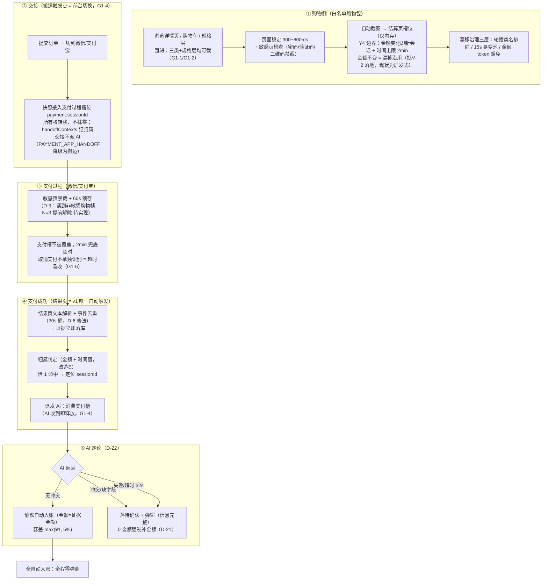
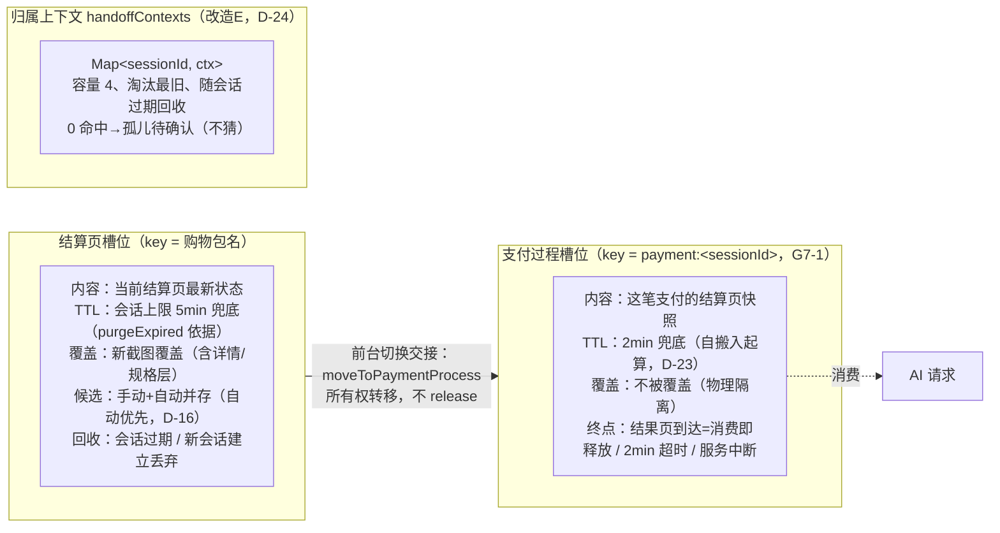
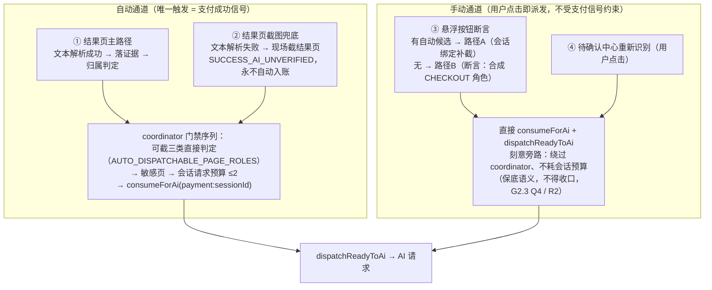
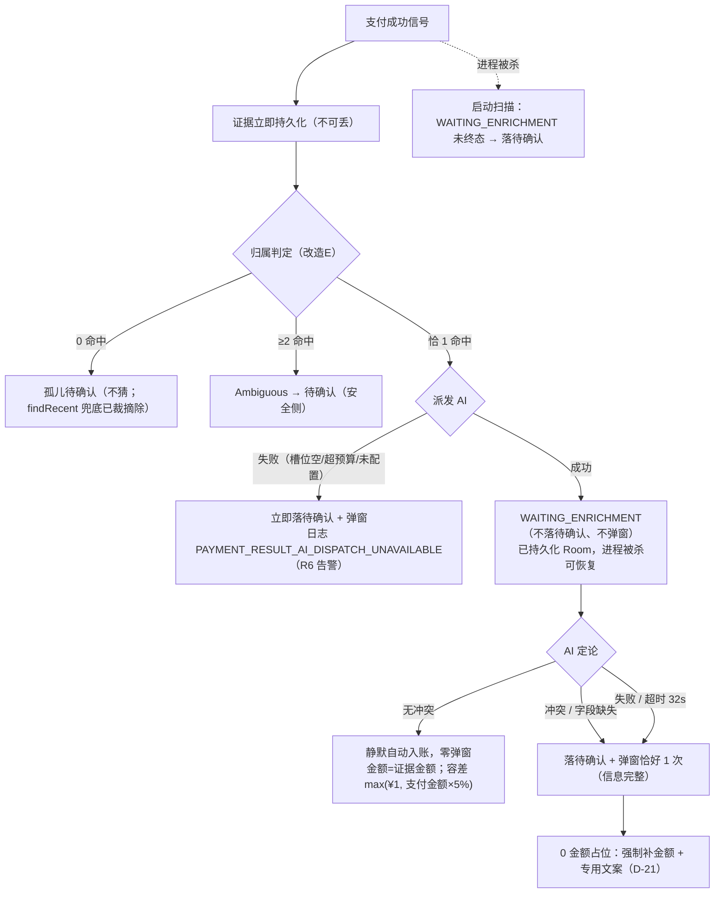
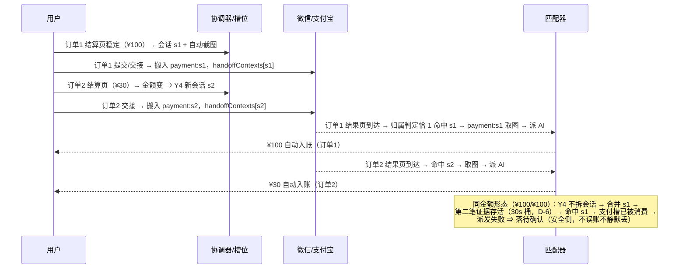

> **状态头**：过程记录（图） | 最后核实 2026-11-04 | 冲突时以 jotbill-app/android 代码为准（导航见 docs/README.md）
# 版本 B 业务流程图（2026-09-13）

> **依据**：`CONFLICT_REVIEW_SESSION_2026-09-11.md`（讨论记录，不确定信息的口径来源）+ `IMPL_PLAN_VERSION_B_2026-09-13.md`（含第二轮/第三轮修正）+ `NEW_PROJECT_KICKOFF_V2.md` 0.3.3。
> **口径声明**：图中不确定信息一律采用 9.11 讨论记录的裁定（G1-1~G6.3 / D-1~D-24）；此后被 9.13 裁定**修订过的数值**以最终裁定为准并在图上标注（如 TTL 2min/5min 分离、去重 30 秒桶）。
> **实现状态标注**：〔已实现〕= 现有代码行为；〔批 V-N〕= 版本 B 待建；〔待实现〕= 已裁定未编码。

---

## 图 1｜端到端主流程（版本 B 全自动链路）

---

## 图 2｜双槽位生命周期与会话归属

---

## 图 3｜AI 派发的 4 条路径与门禁（R1/R2 通道分列）

---

## 图 4｜证据匹配与入账决策树（D-22 落库顺序②）

---

## 图 5｜多订单并发归属（改造E 时序）

---

## 限制清单（含来源裁定编号）

### A. 已接受的设计代价（用户裁定）

| # | 限制 | 出处 |
|---|---|---|
| 1 | 极端慢支付（换卡/验证码 >2min）→ 支付槽图过期 → 落待确认（降级安全侧）。用户原话："2 分钟就已经很不错" | D-23/0.3.3 |
| 2 | 详情页直达支付搬入的是**详情页图** → AI 可能读到非最终价格 → 超容差落待确认（"宽进换不漏"的代价，须计入验收指标） | R6 |
| 3 | **结果页不携带订单号** ⇒ 同金额两单无法自动区分——归属只能靠金额+时间窗；映射化的价值是把"丢失"变"可检测的歧义" | D-24/E-3 |
| 4 | 同包同金额两单相隔 <30s 仍撞去重键（人工连续完成两笔支付的间隔远大于 30s，可忽略） | D-6 修法·甲 |

### B. 已知限制（v1 范围外或待治理）

| # | 限制 | 出处 |
|---|---|---|
| 5 | 应用内支付（多多钱包/京东支付等不跳包）：无结果页、通知已停用 ⇒ **信号源两头断**，v1 不支持；由 ROADMAP 批 5"站内支付结果页"承接 | G3.2/D-14 |
| 6 | 支付通知链路 v1 停用（采集/解析代码保留，`recordPaymentEvidence` 按 sourceType 短路；新版本打开开关即恢复） | D-3/G3.1 |
| 7 | Y3 残余：规格层隐藏节点携带动作词时仍判 CHECKOUT；"10s 内紧跟真结算页"是已知漏网形态（属 Y3/L3 治理域） | QA 5.10.1/5.11 |
| 8 | L3 四弱点：无 viewId 退化裸类名键 / text 与 contentDescription 共键 / 跨层污染 ≤15s / 400 上限静默不追踪；**P8 无标签金额护栏未修**（与金额提取同通道，已并入批 V-2） | QA 5.10/CONFLICTS C4/P8 |
| 9 | 会话 AI 请求上限 2（首次 + 一次实质变化/重试余量） | G6.3 Q4 |
| 10 | 断言通道不耗预算、绕过门禁——**刻意设计不得收口**；路径 A 角色白名单 4 类为死配置（不致害） | G2.3 Q4/G2.7/R2 |
| 11 | 敏感页 60s 锁存误伤手动断言（自动不受影响）；修法已裁定（读到非敏感购物帧 N=3 帧提前解除+负向测试），**待实现** | D-9/G1-8 |
| 12 | 去重幂等：待确认粒度=会话级（一个 sessionId 一条，幂等 upsert） | G2.5 子问③ |
| 13 | **X2 家族：AI 任务静默消失**（三次真机观测、机制未知；32s 超时存在但取消路径绕过结果回调）⇒ D-22 运行期兜底缺口——启动扫描只在下次启动生效，**运行期周期扫描待补** | QA 5.3/5.5/5.10.4 |

### C. 运维形态（MIUI 真机）

| # | 形态 | 处置 |
|---|---|---|
| 14 | 覆盖安装后无障碍服务**假死**（零日志）/"**半死**"（采样全是桌面噪声、购物包零事件） | 黄金脚本第一节必查：摘挂重绑即愈 |
| 15 | 系统静默丢弃 takeScreenshot 回调 | 兜底 8s / 断言 3s 看门狗强制复位（已实现） |

---

## 设计方式（原则与出处）

| 原则 | 内容 | 出处 |
|---|---|---|
| **宽进严出** | 详情/购物车/订单确认（+规格层）都可截图入内存；**自动通道送 AI 的唯一触发 = 支付成功信号**；手动通道由用户点击触发、不受支付信号约束（4 条派发路径，通道分列） | G1-1 / R1 |
| **落袋优先** | 证据立即持久化；任何失败路径都不静默丢钱——最坏也是待确认 | 批 1 真机验证 |
| **准确优先于自动化率** | 歧义/超容差/无归属/无图 → 一律落待确认，**不猜**（0 命中不回退最近活跃会话） | ROADMAP §12 / R4 |
| **方案 β** | 一单一会话一 AI 请求，靠 sessionId 归位；会话请求上限 2 | G1-4/D-5 |
| **事件驱动生命周期** | 图的生命周期 = 这笔支付的生命周期；主终点 = 结果页到达（消费即释放），时长只是兜底 | D-23 |
| **双保险口径** | 宁可重复一条待确认，不冒错账风险 | ROADMAP §12 |
| **隐私红线** | 敏感页零截图（帧级门禁+锁存）；截图仅内存、用后清零；截图兜底须有支付旅程上下文（P1-2 修复） | 不变式 1 / P1-2 |
| **手动 = 保底** | 自动负责"代码认得出的页面"，手动负责"代码认不出的页面"，场景互斥 | G2.6 |
| **金额即事实** | 入账金额 = 支付证据金额（AI 读的是页面）；容差 max(¥1, 5%) 双向有界 | D-19 |
| **会话边界 = 真实事件** | 金额变化即新会话（最强订单边界）+ 时间上限兜底；过渡期机制，journey 锚点为终态（共享金额字段） | G6.3 Q3 / 战略裁决·甲 |
